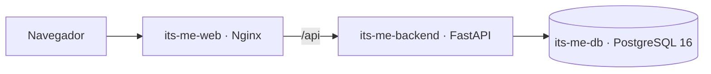

# Arquitectura

## Modelo de datos (EAV)

- `users`: un único usuario; `/api/auth/setup` devuelve 409 cuando ya existe.
- `attributes`: definición (nombre, tipo, región, unidad, opciones, tipo de talle, historial habilitado). Los predefinidos se siembran en la migración inicial; los personalizados se crean desde la UI sin migraciones.
- `entries`: valores (`value_number`, `value_text`, `value_bool`, `unit`, `details` JSON, `measured_on`, `notes`, timestamps). Una fila por medición; el valor vigente es el de `measured_on` más reciente.

Regiones: head, eyes, neck, shoulders, chest, arms, hands, waist, hips, legs, feet, full_body.

## Decisiones

- **Talles sin equivalencias**: el valor se guarda tal cual junto con su sistema (ALPHA, NUM, EU, US, UK, WL). Pantalón W/L guarda `waist` y `length` en `details`.
- **Historial deshabilitado** en un atributo: el nuevo valor reemplaza al anterior, a pedido explícito del usuario al configurar el atributo.
- **Sesión**: JWT firmado en cookie HttpOnly; el backend confía en `X-Forwarded-For` de Nginx (red interna) para limitar intentos de login por cliente.
- **Gráficos y silueta** hechos con SVG propio para evitar dependencias.
